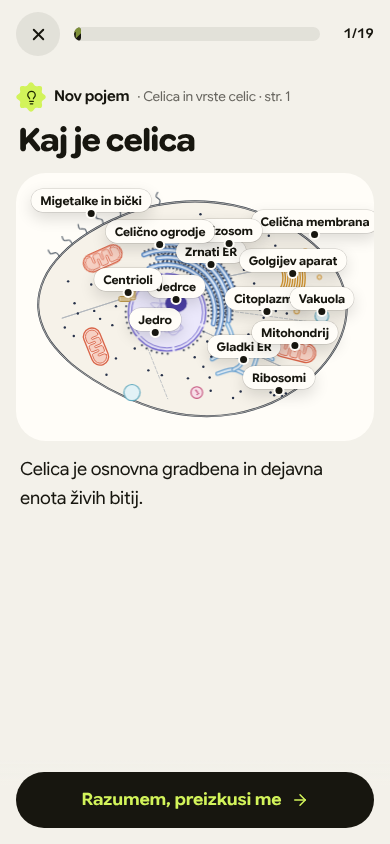

# Bios

Biology you can see. A visual learning app for the cell: organelles, cell theory, the microscope and cell processes, with an interactive 3D cell, animated explanations and 16 task types built around spaced repetition.

This is the **open source, offline build** of [Bios](https://bios.xtrslab.com). It runs entirely in the browser: no accounts, no server, no API keys, no external services. Progress is saved in `localStorage`.

<p align="center">
  
  &nbsp;&nbsp;
  
</p>

## Features

* **Interactive 3D cell** (Three.js): animal, plant and prokaryotic cells, cartoon style with outlines, cutaway and labels, tap an organelle to open its card
* **Animated explanations**: protein pathway, cellular respiration, photosynthesis, digestion in the cell, vacuole and turgor, cilia
* **16 task types**: multiple choice, true or false, type the term, identify the marked part, locate on the cell, odd one out, fix the mistake, cloze, ordering, zoom, explain in your own words and more
* **Daily training** with FSRS spaced repetition and a limit of new concepts per session
* **Lessons and notebook** that follow the source notes page by page
* **Tests with a grade** and a progress view with mastery per topic and per organelle
* Light and dark mode, works on phone and desktop, installable PWA

## What is different from the hosted version

| Hosted version | Open source build |
|---|---|
| Login (Google, email code, password) and cloud progress | No accounts, progress stays in this browser |
| AI grading, AI oral exam, AI generated tasks, speech to text | Disabled, explanations are checked with local key point matching |
| Live Arena with real players | Not available (needs a realtime server) |

Server code, deployment scripts and infrastructure identifiers are not part of this repository.

## Run it

```bash
npm install
npm run dev      # http://localhost:5173
npm run build    # static files in dist/
npm run check    # type check
```

Deploy `dist/` to any static host.

## Stack

React 19, TypeScript, Vite, Three.js, Motion, Lucide.

## License

MIT, see [LICENSE](LICENSE). Made by [Nik Bogataj](https://github.com/nikb12e) · [XTRSlab](https://xtrslab.com).
