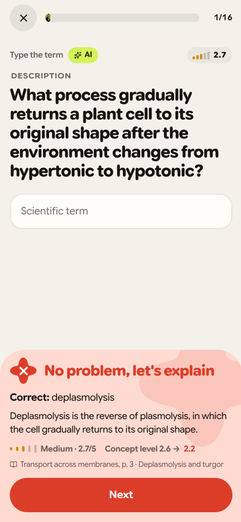
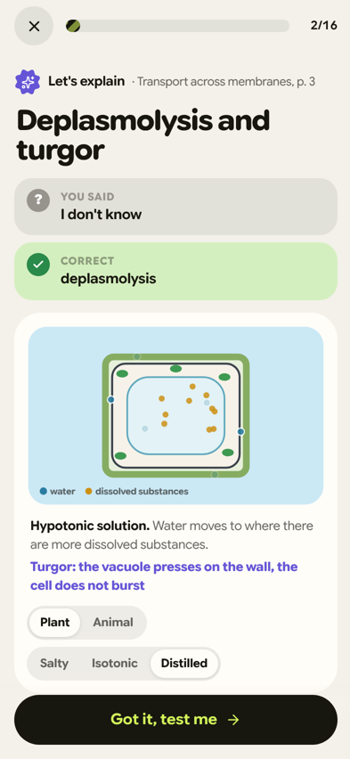
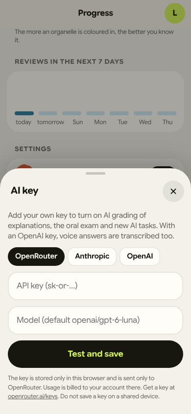

# Bios

Biology you can see. A visual, adaptive learning app for first year upper secondary biology: the cell and its organelles, cell theory, transport across membranes, the microscope, lab work and the basics of science, with an interactive 3D cell, animated explanations and 16 task types built around spaced repetition.

This is the **open source build** of [Bios](https://bios.xtrslab.com). It runs entirely in the browser: no accounts, no server and no API keys built in. Progress is saved in `localStorage`.

AI features are **optional**: add your own OpenRouter, Anthropic or OpenAI key and they switch on. Without a key everything else works offline.

<p align="center">
  
  &nbsp;
  
  &nbsp;
  
</p>

## Features

* **Adaptive practice** (new in 7.0): every task has a difficulty from 1 to 5 and every concept a knowledge level from 1 to 5 (Rasch model and Elo). The app tests first, spends most of the time on what you do not know and checks what you know now and then with a harder task
* **I don't know** button and **explanations only when you struggle**: your answer next to the correct one, an animation, a personal AI explanation and a voice, then a check that you understood
* **Learning from mistakes**: the same concept in another format, a review round at the end, never the same task again right away
* **About 820 tasks**, including 388 AI written tasks that a second, independent model call checked
* **Interactive 3D cell** (Three.js): animal, plant and prokaryotic cells, cartoon style with outlines, cutaway and labels, tap an organelle to open its card
* **Animated explanations**: protein pathway, cellular respiration, photosynthesis, digestion in the cell, vacuole and turgor, cilia in 3D; osmosis, membrane transport, the inverted microscope image, cell size, depth of field, objectives and the steps of research in 2D
* **Ten topics, 111 concepts**: introduction to biology, science and research, the cell, cell theory, organelles, cytoskeleton and membrane, plant and animal cells, transport across membranes, the microscope, lab work
* **16 task types**: multiple choice, true or false, type the term, identify the marked part, locate on the cell, odd one out, fix the mistake, cloze, ordering, zoom, explain in your own words and more
* **Daily training** with FSRS spaced repetition and a limit of new concepts per session
* **Lessons and notebook** that follow the source notes page by page
* **Tests with a grade** and a progress view with mastery per topic and per organelle
* **Bring your own AI key** (OpenRouter, Anthropic or OpenAI): grading of free explanations against the key points, an oral exam with an AI teacher, freshly generated and double checked tasks
* **Sound and voice**: a sound engine that rewards streaks, and explanations read aloud (provider voice with an OpenAI or OpenRouter key, otherwise the browser's own voice)
* **Version history** in the app (Progress → Version history), see also [CHANGELOG.md](CHANGELOG.md)
* Light and dark mode, works on phone and desktop, installable PWA

## What is different from the hosted version

| Hosted version | Open source build |
|---|---|
| Login (Google, email code, password) and cloud progress | No accounts, progress stays in this browser |
| AI on the server, paid by the app | AI with your own key, called straight from your browser; without a key, explanations use self rating with key point hints |
| Server speech to text | OpenAI transcription with an OpenAI key, otherwise the browser's own speech recognition where available |
| Live Arena with real players | Not available (needs a realtime server) |
| Shared task bank on the server, difficulty calibrated from everyone's answers, new tasks written as you practise | The same 388 checked AI tasks ship with the app; difficulty is calibrated from your own answers; new tasks with your key in Practice |
| Slovenian voice for explanations on the server | OpenAI or OpenRouter voice with your key, otherwise the browser's own speech synthesis |

Server code, deployment scripts and infrastructure identifiers are not part of this repository.

## AI with your own key

Open **Progress → Settings → AI key**, pick a provider, paste your key and press **Test and save**.

<p align="center"></p>

| Provider | Default model | Where to get a key |
|---|---|---|
| OpenRouter | `openai/gpt-6-luna` | [openrouter.ai/keys](https://openrouter.ai/keys) |
| Anthropic | `claude-haiku-5-5` | [console.anthropic.com](https://console.anthropic.com/settings/keys) |
| OpenAI | `gpt-6-luna` | [platform.openai.com/api-keys](https://platform.openai.com/api-keys) |

You can type any other model ID your account has access to.

* The key is stored only in your browser (`localStorage`) and sent only to the provider you picked, directly from the browser. No server of mine ever sees it.
* Usage is billed to your own account with that provider.
* Anyone with access to the browser profile can read the key, so do not save it on a shared device. **Remove key** deletes it.
* With a key you also get personal explanations when you struggle, and a natural voice for them with an OpenAI key (`gpt-4o-mini-tts`, which OpenAI plans to retire on 6 January 2027) or an OpenRouter key (ElevenLabs). Without one, explanations come from the notes and the browser reads them aloud.
* Providers live in `src/engine/llm.ts`, prompts in `src/engine/ai.ts` and `src/views/Explain.tsx`. Every AI feature has an offline fallback.

## Run it

```bash
npm install
npm run dev      # http://localhost:5173
npm run build    # static files in dist/
npm run check    # type check
```

Deploy `dist/` to any static host.

## How the adaptive model works

* **Task difficulty** (`src/engine/adapt.ts`): an estimate from the task type and content (scenarios, long options and "why" questions are harder), averaged with the AI's own estimate for AI tasks, then calibrated with your answers (Bayes, five pseudo answers as the prior).
* **Knowledge level** per concept: Elo with a step that shrinks as you answer more; the chance of success is `σ(1.15 × (level − difficulty))`.
* **Picking tasks** (`src/engine/gen.ts`): each concept gets a role (new, weak, due, learning, known) and a target chance of success (0.45 to 0.72); the task closest to it wins, with penalties for tasks seen recently and for repeating a format.
* **FSRS 5** still schedules the reviews; the grade takes into account how hard the task was for you.

## Stack

React 19, TypeScript, Vite, Three.js, Motion, Lucide.

## License

MIT, see [LICENSE](LICENSE). Made by [Nik Bogataj](https://github.com/nikb12e) · [XTRSlab](https://xtrslab.com).
